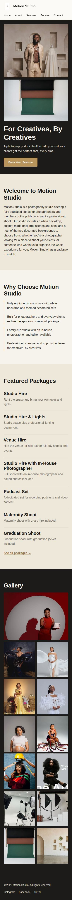
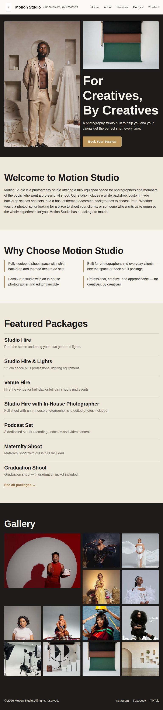
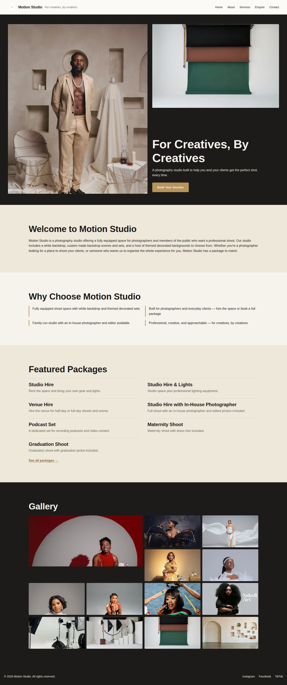

# Motion Studio Website

## Student Information
- **Name:** Khethelo Zondi
- **Student Number:** ST10530976
- **Module:** Web Development (Introduction) - WEDE5020
- **Institution:** The Independent Institute of Education (IIE) - Rosebank College

## Live Links
- **Live website:** ADD YOUR LIVE SITE URL HERE
- **GitHub repository:** ADD YOUR REPOSITORY URL HERE

## Project Overview
Motion Studio is a family-run photography studio in Durban offering studio hire, themed
backdrops, and full photoshoot packages (studio hire, studio hire with lights, venue hire,
studio hire with in-house photographer, podcast set, maternity shoots, and graduation
shoots). This project builds a five-page website for the studio to replace its current
reliance on Instagram, Facebook, and TikTok alone.

## Website Goals and Objectives
- Present all studio packages and pricing clearly in one place.
- Allow visitors to submit a booking enquiry online and see an instant cost estimate.
- Build a more professional, credible online presence for the studio.
- Help local customers find the studio through search engines.
- KPI: number of enquiry form submissions and growth in website visits.

## Key Features and Functionality
- Home page with hero section, call to action, featured packages and a gallery with a lightbox viewer.
- About page with studio history, mission, and team.
- Services page with packages loaded from a JSON file, live search, category tabs, sorting, a details pop-up and a FAQ accordion.
- Enquiry page with a validated booking form that returns a cost estimate, deposit amount and availability message, and submits with AJAX.
- Contact page with studio details, an interactive Leaflet map with two locations (CARTO map tiles built on OpenStreetMap data), and a validated contact form that compiles an email to the studio.
- Custom 404 page, robots.txt, sitemap.xml, structured data and security headers.

## Project Structure
```
motion-studio-website/
├── index.html, about.html, services.html, enquiry.html, contact.html, 404.html
├── css/styles.css                 single stylesheet and design tokens
├── js/
│   ├── main.js                    navigation toggle, scroll animations, back-to-top
│   ├── gallery.js                 jQuery lightbox
│   ├── faq.js                     jQuery accordion
│   ├── services.js                fetch, search, filter, sort, tabs, dialog
│   ├── forms.js                   shared validation helpers
│   ├── enquiry.js                 enquiry form, quote, AJAX submission
│   ├── contact.js                 contact form and email builder
│   └── map.js                     Leaflet map
├── data/
│   ├── packages.json              package data used by the services page
│   ├── locations.json             map locations
│   ├── packages.js, locations.js  backup copies of the data for when the page is opened as a file
├── images/                        optimised photos (480w and 828w versions) and screenshots/
├── vendor/                        self-hosted jQuery 3.7.1 and Leaflet 1.9.4
├── robots.txt
├── sitemap.xml
├── _headers                       security and caching headers for Netlify
└── README.md
```

## Timeline and Milestones
| Phase  | Focus                                              | Target Period |
|--------|-----------------------------------------------------|----------------|
| Part 1 | Planning, content research, HTML structure          | Weeks 1-3      |
| Part 2 | CSS styling, responsive design                      | Weeks 4-6      |
| Part 3 | JavaScript, SEO, testing and final submission       | Weeks 7-9      |

## Contact Details
- **Address:** 39 Station Drive, Durban (second studio: 73 4th Avenue, Windermere)
- **Opening hours:** every day, 07:00 to 17:00
- **Phone:** 075 400 7473
- **Email:** bookings@motionstudioza.com

## Part 1 Details
Part 1 covers the foundational HTML structure of the website:
- Five linked pages: `index.html`, `about.html`, `services.html`, `enquiry.html`, `contact.html`.
- Semantic HTML5 elements (`header`, `nav`, `main`, `section`, `footer`).
- A working navigation menu linking all pages.
- `css/styles.css` and `js/` folders created for later parts.

## Part 2 Details
Part 2 covers the visual design and responsive layout of the site:
- External stylesheet (`css/styles.css`) built around one set of CSS custom properties (colour, type, spacing) so the whole site can be re-themed from one place.
- Colour palette: charcoal ink, off-white paper, and a warm brass gold accent.
- Typography: Archivo (headings) and Work Sans (body) with a fluid type scale using `clamp()`.
- Layout with Flexbox (header, footer, enquiry columns) and CSS Grid (hero collage, gallery, services, team).
- Hover, focus and active states, a visible `:focus-visible` outline and `prefers-reduced-motion` support.
- Mobile-first breakpoints at 600px and 1024px using relative units.
- Responsive images with `srcset`/`sizes` and a `<picture>` element on the About page.

## Part 3 Details
Part 3 adds interactivity, dynamic content, form handling, SEO and deployment.

### JavaScript enhancements
- **Accordion (jQuery):** the FAQ on the Services page opens one answer at a time. The open and close animation is a CSS grid-row transition, and `aria-expanded` is kept in sync for screen readers.
- **Tabs (vanilla JS):** package categories on the Services page use the ARIA tabs pattern with arrow, Home and End key support.
- **Modal (native `<dialog>`):** "View details" opens a package pop-up with what is included, the price and an enquiry link. It closes with Escape, the close button or a click on the backdrop.
- **Interactive map (Leaflet + CARTO tiles with OpenStreetMap data):** the Contact page shows both studio locations with popups and a "Get directions" link. Location buttons move the map to each pin. The map only loads when it scrolls near the viewport.
- **Animations and transitions:** hero and heading fade-up on load, sections reveal on scroll with `IntersectionObserver`, header shadow on scroll, animated menu icon, back-to-top button and a highlight pulse on a deep-linked package. All motion is switched off for visitors who prefer reduced motion.
- **Advanced DOM manipulation:** package cards, tabs, the dialog, the lightbox, the quote table, the email preview and the mobile menu button are all created with `createElement` and `DocumentFragment`. User text is always inserted with `textContent`, never `innerHTML`. The Enquire duration list rebuilds itself for the chosen package.
- **Gallery lightbox (jQuery):** clicking a gallery photo opens a larger view with previous and next buttons, arrow keys, swipe on touch screens, a photo counter, focus trapping and focus return.

### Dynamic content
- Packages are loaded with `fetch()` from `data/packages.json` and rendered by `js/services.js`. A loading message, an error message with a retry button and a `<noscript>` fallback list are included.
- Search matches package names, descriptions, prices and inclusions. Results can be filtered by category tab and sorted by featured order, price (low to high or high to low) or name. A live result count is announced to screen readers.
- If `fetch()` is blocked (for example when a page is opened by double-clicking the file instead of from a web server), the page falls back to `data/packages.js`, a copy of the same data. If a package or location is edited in the JSON file, the matching `.js` file must be updated too.
- Cards from the home page link straight to a package, for example `services.html#maternity-shoot`.

### Forms and validation
- Both forms use HTML5 attributes (`type`, `required`, `min`, `max`, `maxlength`) and JavaScript validation through `js/forms.js`, with `novalidate` so the custom messages show.
- Opening hours (07:00 to 17:00, 7 days a week) are enforced: a start time before 07:00 is rejected, and so is a start time where the booking length would run past 17:00 (the message shows the latest allowed start time).
- Validated formats: names (letters only, 2 to 60 characters), email, South African phone numbers (`075 400 7473` or `+27 75 400 7473`), dates (not in the past and within 12 months), whole-number guest counts (1 to 30) and message lengths.
- Error messages appear under each field, fields are marked with `aria-invalid`, focus moves to the first problem, and errors clear as the visitor corrects them.
- **enquiry.html:** after validation the visitor sees an estimate built from the package rate, duration and extra people (family shoots are exempt from the extra person fee), the 50% deposit, and an availability message for the chosen date. The form sends the enquiry through FormSubmit, which emails it to the studio address, and a success message only shows when FormSubmit confirms it accepted the enquiry. The form posts with AJAX (`fetch`) to the URL in the form `action` attribute (FormSubmit, forwarding to ktzondi63@gmail.com) and shows a success message, or an "email it to us instead" link if sending fails.
- **contact.html:** after validation the message is compiled into an email (to, subject and body) shown in a preview. The visitor can open it in their email app using a `mailto:` link to the recipient set in the form, copy the text, or go back and edit.
- A hidden honeypot field and a consent tick box (POPIA) are included on the enquiry form.

### Search engine optimisation
**Keyword research.** Keywords were chosen from the studio's services and its location, then placed in titles, headings, descriptions, alt text and body copy. They should be validated with Google Keyword Planner or Google Trends once the site is live.

| Page | Primary keyword | Supporting keywords |
|------|-----------------|---------------------|
| Home | photography studio Durban | studio hire Durban, themed backdrops, photoshoot packages |
| About | family-run photography studio Durban | in-house photographer, creative studio |
| Services | studio hire Durban | maternity photoshoot Durban, graduation photoshoot, podcast set hire, venue hire |
| Enquiry | book a studio session Durban | photoshoot cost estimate, studio booking |
| Contact | photography studio Station Drive Durban | contact photography studio, studio address |

**On-page SEO**
- Unique `<title>` (under 60 characters) and meta description (about 150 characters) on every page.
- One `<h1>` per page with `<h2>` and `<h3>` headings in order. The logo text is no longer an `<h1>`.
- Descriptive image file names and meaningful `alt` text, `width` and `height` attributes, lazy loading below the fold and a preloaded hero image.
- Canonical links, Open Graph and Twitter card tags, and JSON-LD structured data (`LocalBusiness` on Home and Contact, `ItemList` of services and `FAQPage` on Services).
- Clean, descriptive page names (`services.html`, `enquiry.html`) and a custom `404.html`.
- Internal links in body copy, deep links from home page packages to the Services page, and a footer navigation on every page.
- Mobile friendly: responsive layout, a collapsible menu on small screens, larger tap targets on buttons and the mobile menu, and a skip link.

**Off-page SEO (plan)**
- **Backlinks:** claim a Google Business Profile for 39 Station Drive, and list the studio on South African business directories such as Yellow Pages South Africa and Hotfrog. Ask photographers, makeup artists, stylists and event planners who use the studio to link to the website.
- **Social media:** put the website link in the Instagram, Facebook and TikTok bios, and share new shoots with a link to the Services page. Open Graph tags make shared links show a preview image.
- **Local SEO:** the studio name, address and phone number are the same on every page and in the structured data. Pages mention Durban, and the Google Business Profile should use the same details.

**Additional requests**
- `robots.txt` allows crawling, blocks the screenshots folder and points to the sitemap.
- `sitemap.xml` lists the five pages with `lastmod`, `changefreq` and `priority`.
- **Page speed:** scripts use `defer`, fonts load with a `<link>` and `display=swap` instead of a CSS `@import`, the Google Maps iframe was replaced with a lighter Leaflet map that loads on demand, jQuery and Leaflet are self-hosted, image `src` fallbacks now point to compressed JPEGs instead of large PNGs, and `_headers` sets caching.
- **Security:** a Content Security Policy that only allows the site's own scripts, `rel="noopener noreferrer"` on every external link, no inline scripts or `innerHTML` with user input, input validation and length limits, a honeypot field, `X-Content-Type-Options`, `X-Frame-Options`, `Referrer-Policy` and `Permissions-Policy` headers, and HTTPS from the hosting platform.

### Deployment
The site is deployed on a free platform (GitHub Pages or Netlify). After deploying, the placeholder `https://YOUR-USERNAME.github.io/motion-studio-website` in the canonical links, Open Graph tags, structured data, `sitemap.xml` and `robots.txt` is replaced with the real live address.

## Testing & Responsive Evidence
The site was tested in Chrome DevTools' device toolbar at mobile, tablet, and desktop widths, confirming the mobile-first breakpoints at 600px and 1024px behave as intended. Screenshots of the home page at each width:

**Mobile (390px)**


**Tablet (768px)**


**Desktop (1440px)**


### Part 3 functional testing
The checks below were run in Chromium against a local copy of the site.

| Area | What was checked | Result |
|------|------------------|--------|
| Lightbox | Opens from a gallery photo, next and previous, Escape to close, caption counter | Passed |
| Services data | Seven packages load from JSON, error state and retry | Passed |
| Search, filter, sort | Search term, empty state, clear filters, category tab, price and name sorting | Passed |
| Modal | Package details dialog opens and closes with Escape | Passed |
| Accordion | Opens one answer and closes the others | Passed |
| Enquiry form | Empty submit shows errors; bad email, phone, past date and guest count rejected; valid submit shows quote, deposit and availability | Passed |
| Quote logic | Hourly rate, extra people, family shoot exemption, venue half and full day | Passed |
| AJAX | Success message shown; fallback email link on failure | Passed |
| Contact form | Message length rule, character counter, email preview and `mailto:` link | Passed |
| Map | Both markers load, location buttons open the popup | Passed |
| Mobile menu | Menu collapses and opens below 600px, no sideways scrolling on any page | Passed |
| Opening hours | Start time before 07:00 and a start time that runs past 17:00 rejected, 15:00 accepted for 2 hours | Passed |
| File opening | Packages, search and map still load when a page is opened as a local file | Passed |
| Console | No JavaScript or Content Security Policy errors on any page | Passed |

## Sitemap
```
Home (index.html)
├── About (about.html)
├── Services (services.html)
├── Enquiry (enquiry.html)
├── Contact (contact.html)
└── 404 (404.html)
```

## Changelog

### Part 3: changes made from Part 2 feedback
- **Detailed README (feedback: no README detail):** rewrote this document with student information, live links, project structure, a feature list for each part, the SEO plan, testing evidence, a full changelog and an updated reference list.
- **Detailed commit messages (feedback: no detailed commits):** from Part 3 onward every change is committed separately with a message that says what changed and why, for example `Add accordion FAQ to services page using jQuery` instead of `update`.
- **Folder structure (Part 1 feedback of 2/5):** the project now has clearly separated folders: `css/`, `js/` (one file per feature), `data/`, `images/`, `images/screenshots/` and `vendor/`, and the structure is documented above. `script.js` was replaced by feature files.
- **Heading structure:** the logo text was an `<h1>` on every page, so pages had two top-level headings. It is now a `<span>`, each page has one `<h1>`, and the section headings below it were moved up a level. The CSS was updated so the pages look the same as before.
- **Contact page map:** replaced the Google Maps iframe with a Leaflet map showing both studio addresses with directions links.
- **Social links:** the home page footer linked to a different Instagram account from the Contact page. All pages now use `instagram.com/motion.studioz/` and every external link has `rel="noopener noreferrer"`.
- **srcset widths:** corrected the width descriptors on images whose real file width did not match the label (for example `client-naledi-art-828w.jpg` is 492px wide) and added `width` and `height` to every image to stop layout shift.
- **Call to action band:** the closing call-to-action text was centred while its button sat on the left. It is now left aligned with the button.
- **Fonts:** moved Google Fonts from a CSS `@import` to a `<link>` in each page head so the stylesheet no longer waits for the font request.

### Part 3: new features
- **Changed** the address that enquiries and compiled contact emails are sent to (form `action`, `data-recipient` and the email fallback link) to ktzondi63@gmail.com.
- **Added** opening hours (7 days a week, 07:00 to 17:00) to the contact details, footer, FAQ, structured data and enquiry form time validation.
- **Added** `data/packages.js` and `data/locations.js` as backup copies of the JSON data so the packages and map still load when the site is opened as a local file.
- **Changed** the enquiry form so the success message only shows when FormSubmit confirms the enquiry was accepted.
- **Added** `js/main.js`: collapsible mobile menu, current page highlight with `aria-current`, header shadow on scroll, scroll reveal animations, back-to-top button and automatic copyright year.
- **Added** `js/gallery.js`: jQuery lightbox for the home page gallery with keyboard, swipe and focus handling.
- **Added** `js/faq.js` and a FAQ section on the Services page: jQuery accordion with `aria-expanded` and a CSS height transition.
- **Added** `data/packages.json` and `js/services.js`: packages are fetched and rendered dynamically with search, category tabs, sorting, result count, empty and error states, a native `<dialog>` details pop-up, and deep links from the home page.
- **Added** `js/forms.js`: shared validators for names, emails, South African phone numbers, dates, guest counts, selects, checkboxes and text length, with accessible error messages.
- **Added** `js/enquiry.js`: live estimate, package prefill from the Services page link, duration options that change per package, quote and 50% deposit calculation, availability message, AJAX submission with timeout and email fallback.
- **Added** `js/contact.js`: validated contact form with a character counter, compiled email preview, `mailto:` link and copy button. The recipient (ktzondi63@gmail.com) is stated in the form `action` and `data-recipient` attribute.
- **Added** `data/locations.json` and `js/map.js`: Leaflet map with markers, popups, location buttons and lazy loading. Map tiles come from CARTO (OpenStreetMap data) because OpenStreetMap's own tile servers block requests that do not come from a live website address. If tiles fail to load, a link to Google Maps is shown.
- **Added** a consent tick box and honeypot field to the enquiry form and a honeypot field to the contact form.
- **Added** SEO: unique titles and descriptions, canonical links, Open Graph and Twitter tags, JSON-LD structured data, internal links, footer navigation with address, `robots.txt`, `sitemap.xml` and `404.html`.
- **Added** security and performance: Content Security Policy meta tag, `_headers` file, deferred scripts, preload for the hero image, lazy loading images and self-hosted libraries in `vendor/`.
- **Added** Part 3 sections to `css/styles.css`: mobile menu, lightbox, package cards, tabs, dialog, accordion, form errors, response panels, map and footer additions, plus reduced-motion rules.
- **Updated** all five pages to share the same header, footer and skip link, and updated this README.

### Earlier parts
- **Part 2 (complete):** Visual design and bug-fix pass across the whole site.
  Fixed several photos (hero portrait, "What Makes Motion Studio Different",
  the founder portrait, the Services and Enquiry page images, and three
  gallery photos) that were cropping people's faces out under
  `object-fit: cover` — added a per-photo `object-position` so every portrait
  stays properly framed wherever it's reused across pages. Fixed a layout bug
  where `<picture>` elements (inline by default) were silently breaking
  `width: 100%` on the About page's studio photo. Fixed a CSS specificity bug
  where the odd/even alternating section-background rule could override the
  dark CTA band's own background depending on how many sections came before
  it on a given page (visible on the Contact page, where the closing CTA text
  was rendering almost invisible). Fixed page-heading paragraphs
  (Services/Enquiry) being auto-centred instead of sitting flush under the
  heading, and removed the old `align="center"/"left"` HTML attributes on
  Services that had been worked around it. Fixed the photo gallery grid
  leaving empty cells at tablet/desktop — the implicit grid rows were sized
  to the tall 2×2 feature photo while the smaller photos kept a fixed height,
  leaving dead space; switched to a uniform `grid-auto-rows` with images at
  `height: 100%` so every cell fills exactly, and added `grid-auto-flow:
  dense` alongside a subtle hover zoom. Rebuilt the "Meet the Team" section
  (previously one small tile with a large empty gap beside it) into a proper
  founder-spotlight layout with the photo beside the bio. Gave the About page
  banner photo and "What Makes Motion Studio Different" photo more presence
  (taller, with a soft shadow) now that they're correctly framed, and added a
  second photo to the Contact page so it isn't the only page without one.
  Added subtle shadows (header, buttons, images) for depth consistent with
  the site's existing flat/editorial look, and a hover-lift on buttons.
- **Part 2 (complete):** Added a "Testing & Responsive Evidence" section to this
  README with mobile, tablet, and desktop screenshots of the home page
  (`images/screenshots/`), confirming the breakpoints behave as intended.
- **Part 2 (complete):** Built out `css/styles.css` with a full design system —
  colour and type custom properties, base/reset styles, typography scale,
  Flexbox/Grid desktop layout (including `grid-template-areas` for the hero
  collage), hover/focus/active states, and mobile-first responsive breakpoints
  at 600px and 1024px. Added `srcset`/`sizes` to hero, gallery, and package
  images and a `<picture>` element on the About page, with generated 480w/828w
  image variants in `images/`. Added Google Fonts (Archivo, Work Sans)
  preconnect links to the `<head>` of all five pages. No corrections were
  required from Part 1 feedback at the time of this submission; the HTML
  structure carries over unchanged aside from wrapping the homepage hero text
  in a `<div class="hero-text">` so it could be targeted as a single CSS Grid
  area.
- **Part 1 (complete):** All five HTML pages finalised with semantic structure,
  working navigation, Motion Studio images, gallery, service descriptions with
  supplied pricing, enquiry form fields (including preferred time and number of
  people), contact details, embedded map, and HTML comments. CSS and JS left as
  placeholders for Parts 2–3.
- **Part 1:** Initial project setup, folder structure, and HTML pages created
  with navigation and base content.

## Images
All images in `images/` are original Motion Studio photography supplied for this
project. Files used:
- `hero-wall.png` — gallery
- `hero-backdrops.png` — homepage hero and gallery
- `logo.png` — site header logo
- `studio-equipment.png` — about page
- `gallery-celebration.png` — homepage gallery
- `team-member.png` — about page team section

For Part 2, each photo above (aside from the logo) was resized into `-480w.jpg`
and `-828w.jpg` variants for use in `srcset`/`sizes` and the About page
`<picture>` element, so mobile devices load a smaller file.

## References
Sources consulted while researching, building and optimising this website:

Afrihost (n.d.) *Web hosting packages*. Available at: https://www.afrihost.com/ (Accessed: 6 August 2026).

Digital Silk (2024) *Top 50 small business website statistics*. Available at: https://www.digitalsilk.com/web-design/web-trends/small-business-website-statistics/ (Accessed: 6 August 2026).

FormSubmit (n.d.) *FormSubmit documentation*. Available at: https://formsubmit.co/ (Accessed: 26 October 2026).

Google Fonts (n.d.) *Archivo* and *Work Sans*. Available at: https://fonts.google.com/ (Accessed: 11 September 2026).

Google Search Central (n.d.) *Search Engine Optimization (SEO) Starter Guide*. Available at: https://developers.google.com/search/docs/fundamentals/seo-starter-guide (Accessed: 26 October 2026).

Google Search Central (n.d.) *Introduction to robots.txt*. Available at: https://developers.google.com/search/docs/crawling-indexing/robots/intro (Accessed: 26 October 2026).

Leaflet (n.d.) *Leaflet: an open-source JavaScript library for interactive maps*. Available at: https://leafletjs.com/ (Accessed: 26 October 2026).

jQuery (n.d.) *jQuery API documentation*. Available at: https://api.jquery.com/ (Accessed: 26 October 2026).

Mozilla Developer Network (n.d.) *Mobile first - MDN Web Docs Glossary*. Available at: https://developer.mozilla.org/en-US/docs/Glossary/Mobile_First (Accessed: 6 August 2026).

Mozilla Developer Network (n.d.) *\<dialog\>: The Dialog element*. Available at: https://developer.mozilla.org/en-US/docs/Web/HTML/Element/dialog (Accessed: 26 October 2026).

Mozilla Developer Network (n.d.) *Client-side form validation*. Available at: https://developer.mozilla.org/en-US/docs/Learn_web_development/Extensions/Forms/Form_validation (Accessed: 26 October 2026).

Mozilla Developer Network (n.d.) *Fetch API*. Available at: https://developer.mozilla.org/en-US/docs/Web/API/Fetch_API (Accessed: 26 October 2026).

Mozilla Developer Network (n.d.) *Intersection Observer API*. Available at: https://developer.mozilla.org/en-US/docs/Web/API/Intersection_Observer_API (Accessed: 26 October 2026).

Mozilla Developer Network (n.d.) *Content Security Policy (CSP)*. Available at: https://developer.mozilla.org/en-US/docs/Web/HTTP/CSP (Accessed: 26 October 2026).

OpenStreetMap (n.d.) *Copyright and license*. Available at: https://www.openstreetmap.org/copyright (Accessed: 26 October 2026).

CARTO (n.d.) *Basemap attribution*. Available at: https://carto.com/attributions (Accessed: 27 October 2026).

Schema.org (n.d.) *LocalBusiness*. Available at: https://schema.org/LocalBusiness (Accessed: 26 October 2026).

Sitemaps.org (n.d.) *Sitemaps XML format*. Available at: https://www.sitemaps.org/protocol.html (Accessed: 26 October 2026).

W3C Web Accessibility Initiative (n.d.) *ARIA Authoring Practices Guide: Tabs and Accordion patterns*. Available at: https://www.w3.org/WAI/ARIA/apg/patterns/ (Accessed: 26 October 2026).
